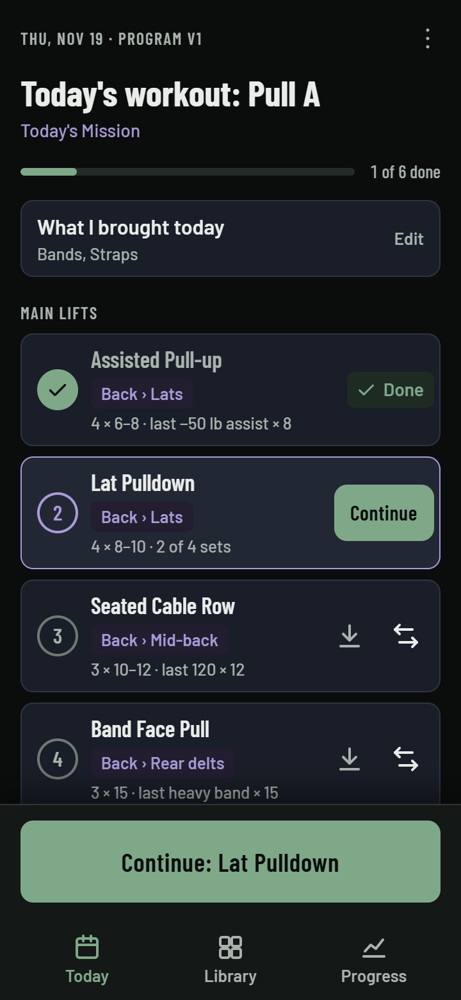
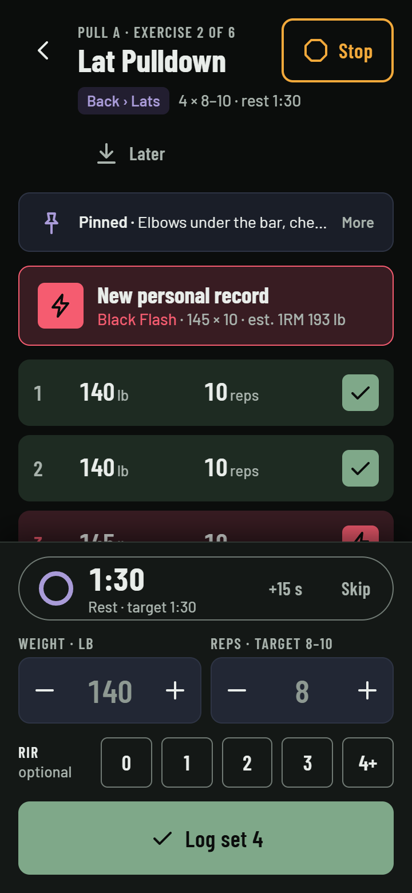
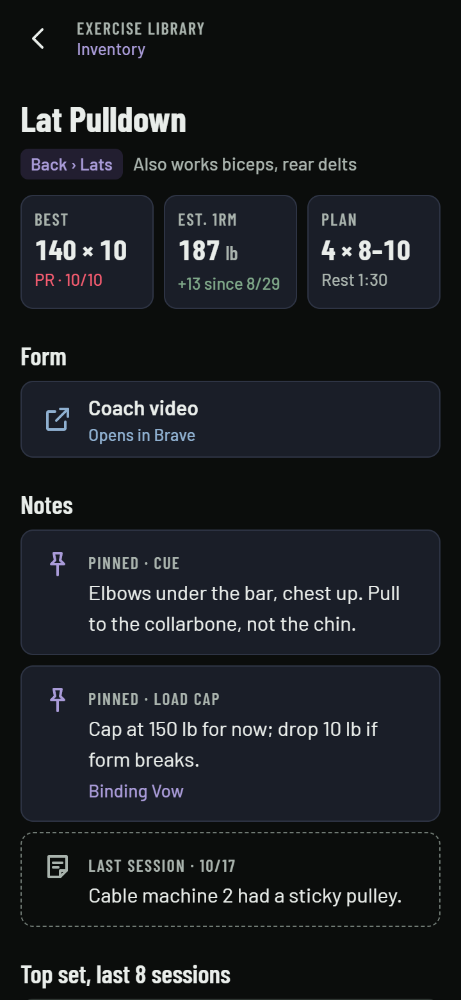
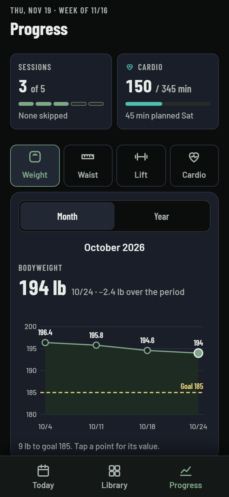
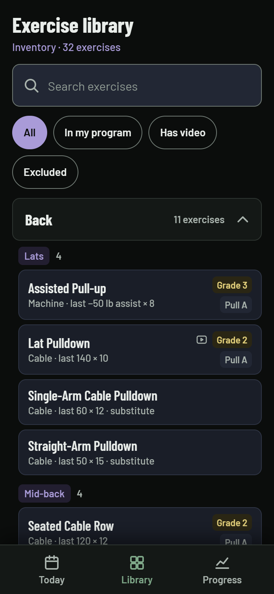
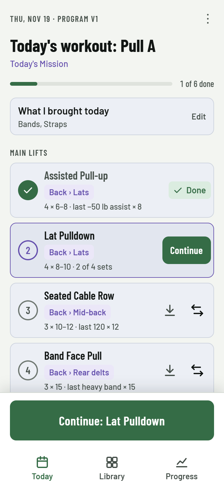

# heavenly-restriction
A self-hosted workout tracker for training hard within injury limits. FastAPI + PWA, offline logging, passkey login, private by design.

**Status:** early build. Program import, today's session, set logging, the library, exercise cards and progress work on real data; login, program editing and media upload are not built yet.

<p>
  
  
  
  
  
  
</p>

Screenshots use the app's built-in demo data (a made-up program and history), captured at 360 × 780 with `npm --prefix frontend run screenshots`.

## How it's built
- **Design:** the screens and the design system (`design-system/`, `docs/DESIGN.md`) were designed in claude.ai.
- **Code:** written with Claude Code.
- **Scope, decisions and review:** mine. I set the scope, made or reviewed the decisions, and checked the changes before they went in.
- **Stack:** Python 3.12, FastAPI, SQLAlchemy 2 + Alembic on SQLite; a Svelte 5 PWA with Dexie (IndexedDB) so a set logs with no signal and syncs later. One origin, no third-party services.
- **Privacy:** the real program and logs never enter the repo. The program is imported from a spreadsheet kept outside it, demo data is made up, and a local pre-commit hook blocks any staged line that contains a string from a private, gitignored list.

## Run it (Windows, PowerShell)
For now the app runs natively on a Windows workstation; the Docker setup below is not tested yet. Requires Python 3.12 and Node.js 20 or later.

One-time setup, from the repo root:

```powershell
py -3.12 -m venv .venv
.\.venv\Scripts\pip install -r backend\requirements-dev.txt
.\.venv\Scripts\pre-commit install
npm --prefix frontend install
if (-not (Test-Path .env)) { Copy-Item .env.example .env }
```

Edit `.env`: set `DATABASE_URL` (for example `sqlite:///C:/path/to/heavenly-restriction/data/hr.db`) and `PROGRAM_XLSX_PATH` (the spreadsheet, kept outside the repo). Then create the database and import the program; run the import again whenever the spreadsheet changes:

```powershell
.\.venv\Scripts\alembic -c backend\alembic.ini upgrade head
$env:PYTHONPATH = "backend"
.\.venv\Scripts\python -m app.importer
```

Re-running updates the same program version. Anything the importer cannot map cleanly is listed in `internal_docs\import-obstacles.md` (local only) instead of being guessed.

Build the app and serve it, API and PWA from one origin, at http://127.0.0.1:8000:

```powershell
npm --prefix frontend run build
.\.venv\Scripts\python -m uvicorn app.main:app --app-dir backend --host 127.0.0.1 --port 8000
```

To reach it from the phone, publish it to your tailnet over HTTPS with `tailscale serve --bg 8000` and open `https://app.example.ts.net`.

Frontend with live reload while developing, at http://localhost:5173 (it proxies `/api` to the server above):

```powershell
npm --prefix frontend run dev
```

## Docker (not tested yet)
Planned for the NAS. Requires Docker with Compose v2. The container runs as an unprivileged user on its own network, with a read-only filesystem except the `hr-data` volume (the SQLite database). The spreadsheet is mounted read-only from outside the repo; set `PROGRAM_XLSX_HOST_PATH` in `.env` first (see `.env.example`).

```powershell
docker compose up -d --build
docker compose exec app python -m app.importer
```

The app listens on `127.0.0.1:8000` only; publish it with `tailscale serve` as above. The importer's obstacles report goes to the volume at `/app/data/import-obstacles.md`.

## Checks before committing

```powershell
.\.venv\Scripts\pre-commit run --all-files
.\.venv\Scripts\python -m pytest
npm --prefix frontend test
```

The pre-commit hooks include the private-strings leak guard. It reads `internal_docs\private-strings.txt` (one string per line, gitignored) and is skipped with a note when that file does not exist.

## Credits
Design and development by Carl Lochstampfor ([CLochstampfor60](https://github.com/CLochstampfor60)).

Built with help from Claude by Anthropic.

Copyright (c) 2026 Carl Lochstampfor (CLochstampfor60). Released under the MIT License; see [LICENSE](LICENSE).
