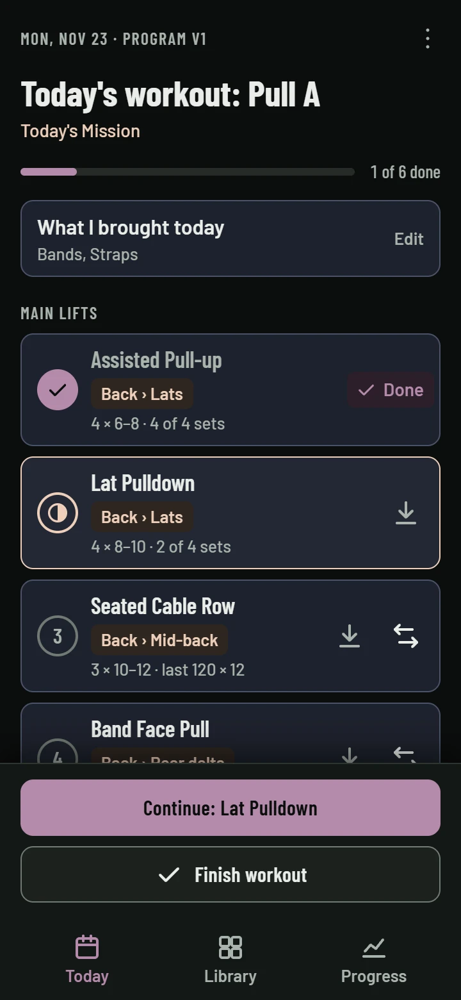
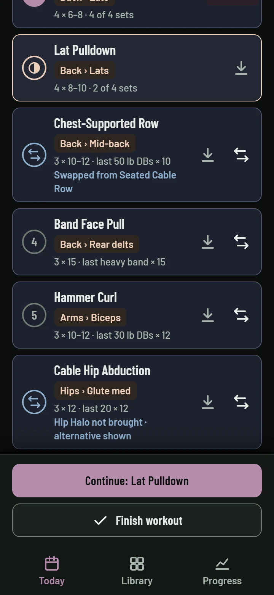
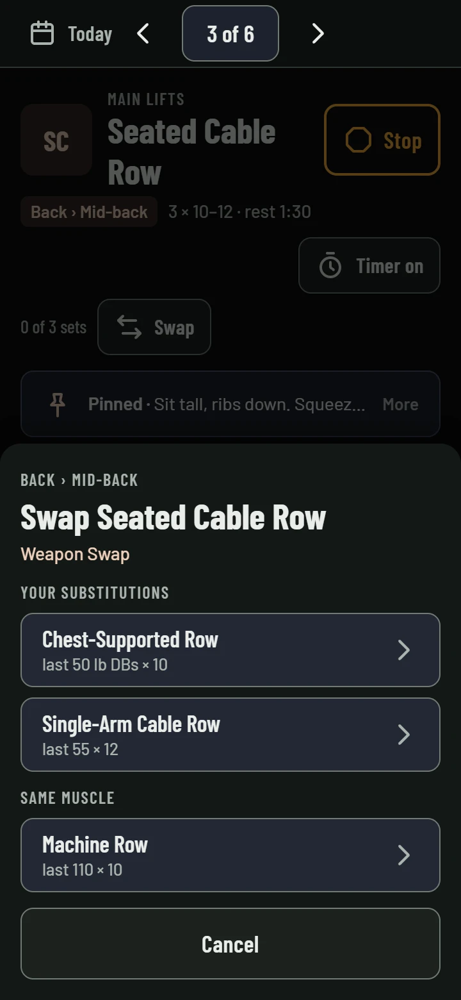
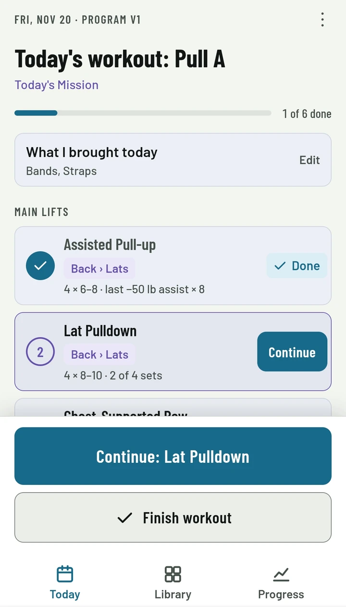
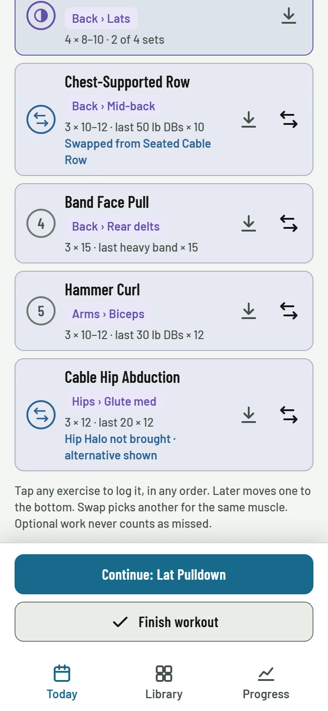
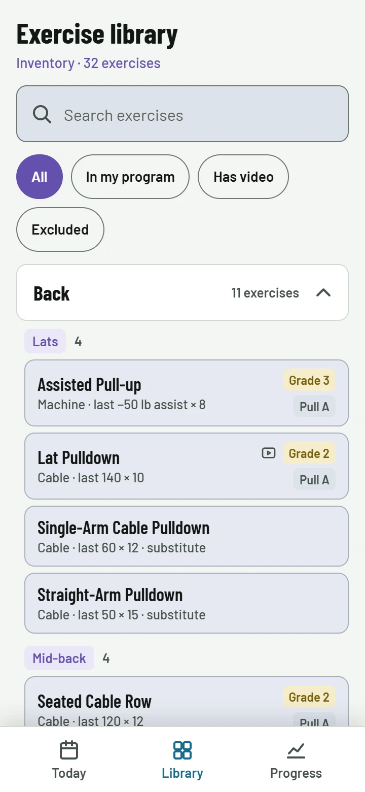
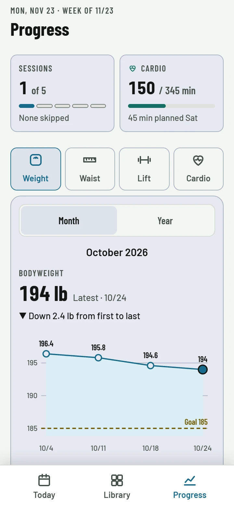
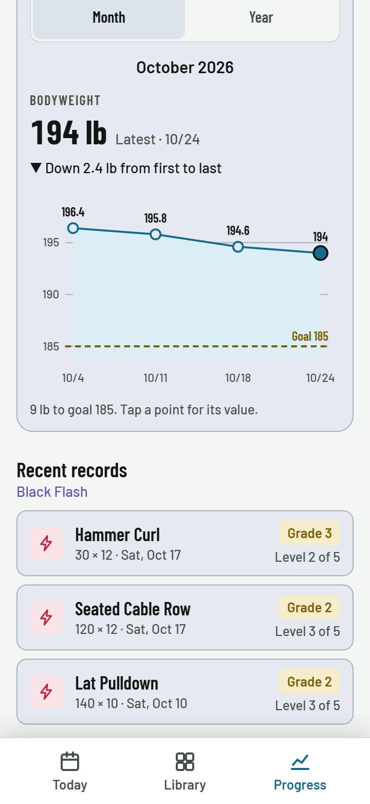
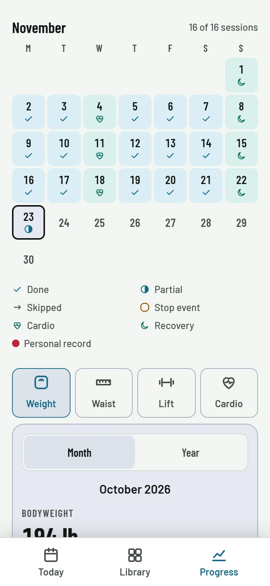

# heavenly-restriction
A self-hosted workout tracker for training hard within injury limits. FastAPI + PWA, offline logging, passkey login, private by design.

**Status:** early build. Program import, today's session, set logging, the library, exercise cards and progress work on real data; login, program editing and media upload are not built yet.

<table>
  <tr>
    <td align="center" width="33%"><br><b>Today's workout</b><br><sub>Dark theme, Plum (Toji) accent</sub></td>
    <td align="center" width="33%"><br><b>Swaps and gear</b><br><sub>Swapped exercises and the next ones</sub></td>
    <td align="center" width="33%"><br><b>Swap an exercise</b><br><sub>Your substitutions, then same muscle</sub></td>
  </tr>
  <tr>
    <td align="center" width="33%"><br><b>Light theme</b><br><sub>Blue (Six Eyes) accent</sub></td>
    <td align="center" width="33%"><br><b>Alternatives</b><br><sub>Shown when gear wasn't brought</sub></td>
    <td align="center" width="33%"><br><b>Exercise library</b><br><sub>By body region and muscle</sub></td>
  </tr>
  <tr>
    <td align="center" width="33%"><br><b>Progress</b><br><sub>Sessions, cardio and bodyweight</sub></td>
    <td align="center" width="33%"><br><b>Bodyweight and sets</b><br><sub>Goal line, sets per muscle group</sub></td>
    <td align="center" width="33%"><br><b>Calendar and records</b><br><sub>Done, cardio, recovery and PRs</sub></td>
  </tr>
</table>

Screenshots are from the phone (Galaxy S23, Brave) in the app's demo mode: a made-up program and history, never real data. They are cropped to the app, with the browser bar removed. `npm --prefix frontend run screenshots` makes a matching set from the demo data in headless Edge.

## How it's built
- **Design:** the screens and the design system (`design-system/`, `docs/DESIGN.md`) were designed in claude.ai.
- **Code:** written with Claude Code.
- **Scope, decisions and review:** mine. I set the scope, made or reviewed the decisions, and checked the changes before they went in.
- **Stack:** Python 3.12, FastAPI, SQLAlchemy 2 + Alembic on SQLite; a Svelte 5 PWA with Dexie (IndexedDB) so a set logs with no signal and syncs later. One origin, no third-party services.
- **Security:** threat model and decisions, done and planned, in [docs/SECURITY.md](docs/SECURITY.md).
- **Changes:** release notes for each version in [CHANGELOG.md](CHANGELOG.md).
- **Privacy:** the real program and logs never enter the repo. The program is imported from a spreadsheet kept outside it, demo data is made up, and a local pre-commit hook blocks any staged line that contains a string from a private, gitignored list.

## Run it (Windows, PowerShell)
For now the app runs natively on a Windows workstation; the Docker setup below is not tested yet. Requires Python 3.12 and Node.js 20 or later.

One-time setup, from the repo root:

```powershell
py -3.12 -m venv .venv
.\.venv\Scripts\pip install -r backend\requirements-dev.txt
.\.venv\Scripts\pre-commit install
npm --prefix frontend install
if (-not (Test-Path .env)) { Copy-Item .env.example .env }
```

Edit `.env`: set `DATABASE_URL` (for example `sqlite:///C:/path/to/heavenly-restriction/data/hr.db`) and `PROGRAM_XLSX_PATH` (the spreadsheet, kept outside the repo). Then create the database and import the program; run the import again whenever the spreadsheet changes:

```powershell
.\.venv\Scripts\alembic -c backend\alembic.ini upgrade head
$env:PYTHONPATH = "backend"
.\.venv\Scripts\python -m app.importer
```

Re-running updates the same program version. Anything the importer cannot map cleanly is listed in `internal_docs\import-obstacles.md` (local only) instead of being guessed.

Build the app and serve it, API and PWA from one origin, at http://127.0.0.1:8000:

```powershell
npm --prefix frontend run build
$env:PYTHONPATH = "backend"
.\.venv\Scripts\python -m app
```

The server answers on loopback only, so real data is never on the LAN: `python -m app` binds 127.0.0.1 and refuses any other address, and requests whose socket peer is not loopback get 403.

Open **http://localhost:8000** (not 127.0.0.1: passkeys are tied to the hostname). Everything except sign-in needs a session. On the first start the server console prints a one-time setup code; enter it on the sign-in screen to create your first passkey, then sign in with it.

To reach it from the phone, publish it to your tailnet over HTTPS as the Tailscale Service `svc:hr` and open `https://hr.<tailnet>.ts.net`; the policy, commands and checks are in [docs/TAILSCALE.md](docs/TAILSCALE.md).

To keep it running without a terminal (Windows), install it as a Task Scheduler task. It runs at logon with no console window (a small supervisor under `pythonw.exe`), starts the server again after every exit, and logs each start and exit, with the reason, to `%LOCALAPPDATA%\HeavenlyRestriction\logs\server.log`:

```powershell
.\scripts\windows\server.ps1 install    # register the logon task and start it now
.\scripts\windows\server.ps1 status     # task, supervisor, server, health, last exit in words, log tail
.\scripts\windows\server.ps1 stop       # stop it and keep it stopped, also across logons
.\scripts\windows\server.ps1 start      # start it again
.\scripts\windows\server.ps1 uninstall
```

The `tailscale serve` config for `svc:hr` is saved by the Tailscale service itself and survives restarts; check it with `tailscale serve status`.

Frontend with live reload while developing, at http://127.0.0.1:5173 (it proxies `/api` to the server above):

```powershell
npm --prefix frontend run dev
```

`--host` is refused, because it would put the proxied real data on the LAN. To look at the UI from another device, use demo data with no API at all:

```powershell
npm --prefix frontend run dev:lan-demo
```

## Docker (not tested yet)
Planned for the NAS. Requires Docker with Compose v2. The container runs as an unprivileged user on its own network, with a read-only filesystem except the `hr-data` volume (the SQLite database). The spreadsheet is mounted read-only from outside the repo; set `PROGRAM_XLSX_HOST_PATH` in `.env` first (see `.env.example`).

```powershell
docker compose up -d --build
docker compose exec app python -m app.importer
```

The app listens on `127.0.0.1:8000` only; publish it with `tailscale serve` as above. The importer's obstacles report goes to the volume at `/app/data/import-obstacles.md`.

## Checks before committing

```powershell
.\.venv\Scripts\pre-commit run --all-files
.\.venv\Scripts\python -m pytest
npm --prefix frontend test
```

The pre-commit hooks include the private-strings leak guard. It reads `internal_docs\private-strings.txt` (one string per line, gitignored) and is skipped with a note when that file does not exist.

## Credits
Design and development by Carl Lochstampfor ([CLochstampfor60](https://github.com/CLochstampfor60)).

Built with help from Claude by Anthropic.

Copyright (c) 2026 Carl Lochstampfor (CLochstampfor60). Released under the MIT License; see [LICENSE](LICENSE).
